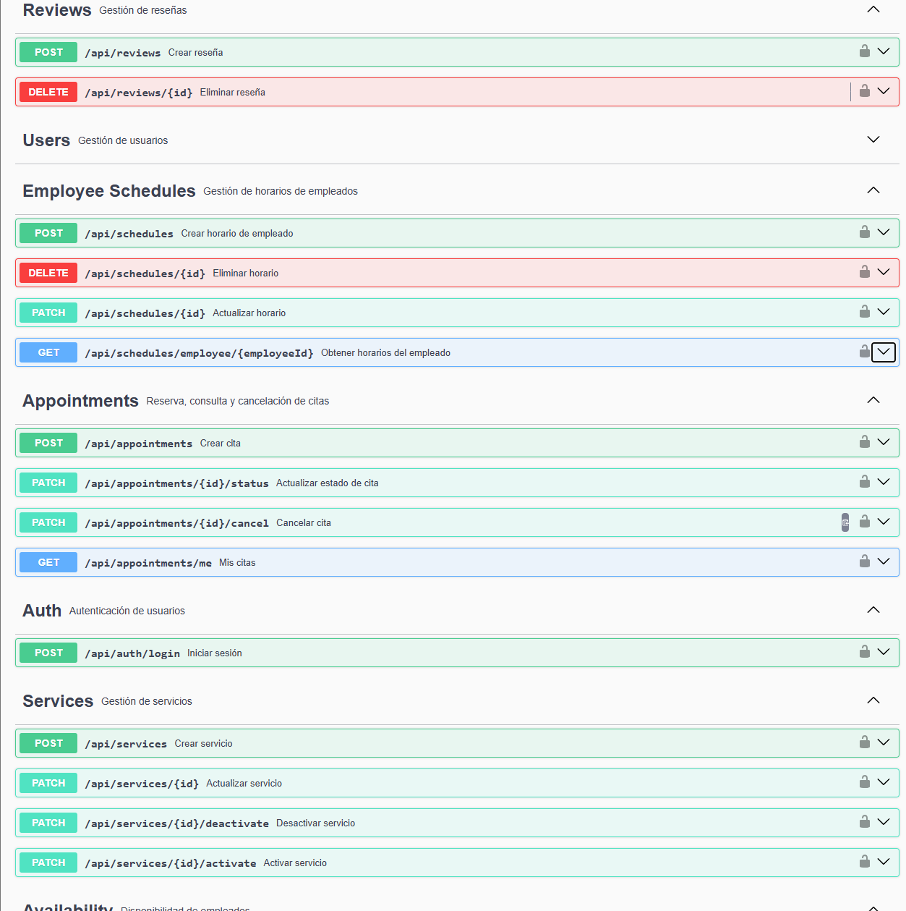

# Slotlyfy

Backend de una plataforma SaaS de reservas multi-negocio (tipo Booksy), construida con Spring Boot. Permite a negocios de servicios (peluquerías, barberías, spas, clínicas de terapia, etc.) gestionar empleados, horarios y servicios, mientras los clientes buscan disponibilidad real y reservan citas online.

Proyecto personal construido para practicar y demostrar un nivel de backend más allá de un CRUD básico: seguridad real con JWT y control de acceso por rol/propiedad, un algoritmo de disponibilidad horaria calculado desde cero, caché con invalidación, y notificaciones por email.

> ⚠️ Proyecto en desarrollo activo. El backend está funcionalmente completo en su flujo principal (negocios, empleados, servicios, horarios, disponibilidad, reservas, reseñas), con tests automatizados; queda pendiente el despliegue en un servidor real.

---

## Índice

- [Qué hace la app](#qué-hace-la-app)
- [Stack técnico](#stack-técnico)
- [Decisiones técnicas destacadas](#decisiones-técnicas-destacadas)
- [Modelo de datos](#modelo-de-datos)
- [Seguridad](#seguridad)
- [Cómo levantarlo en local](#cómo-levantarlo-en-local)
- [Despliegue con Docker](#despliegue-con-docker)
- [Endpoints principales](#endpoints-principales)
- [Roadmap / pendiente](#roadmap--pendiente)
- [Autor](#autor)

---

## Qué hace la app

Slotlyfy conecta dos tipos de usuario:

- **Dueños de negocio (`BUSINESS_OWNER`)**: crean su negocio, dan de alta empleados con su horario semanal, publican los servicios que ofrecen (con duración y precio), gestionan las citas que les llegan y pueden consultar las reseñas que reciben.
- **Clientes (`CLIENT`)**: buscan negocios por categoría, consultan los servicios y la disponibilidad real de cada empleado para una fecha concreta, reservan, cancelan sus propias citas y dejan una reseña una vez completado el servicio.

El corazón del proyecto es el **cálculo de disponibilidad**: a partir del horario semanal de un empleado, la duración del servicio elegido y las citas ya existentes ese día, el sistema genera en tiempo real los huecos libres reales — no son horas fijas predefinidas, se calculan dinámicamente.

## Stack técnico

- **Java 25**
- **Spring Boot** (Spring Web, Spring Data JPA, Spring Security, Spring Cache, Spring Mail)
- **MySQL** como base de datos relacional
- **JWT** (JJWT) para autenticación stateless
- **Lombok** para reducir boilerplate
- **Jakarta Bean Validation** para validación de DTOs
- **Mailtrap** (SMTP sandbox) para notificaciones por email en desarrollo
- **Maven** como gestor de dependencias

## Decisiones técnicas destacadas

Algunas partes del proyecto en las que creo que vale la pena fijarse:

- **Algoritmo de disponibilidad horaria** (`AvailabilityService`): combina el horario semanal del empleado (`EmployeeSchedule`), la duración del servicio elegido y las citas ya reservadas ese día para generar los huecos libres reales, detectando solapes con la fórmula clásica de intervalos (`A.start < B.end && B.start < A.end`).

- **Seguridad en dos capas**: `@PreAuthorize` a nivel de rol (`BUSINESS_OWNER`, `CLIENT`) combinado con comprobaciones explícitas de *ownership* dentro de cada service (por ejemplo, que el negocio del recurso que se quiere modificar pertenezca realmente al usuario autenticado, o que una cita sea del cliente que intenta cancelarla). El rol por sí solo nunca es suficiente para autorizar una acción sobre un recurso ajeno.

- **Borrado lógico (*soft delete*)** mediante un campo `active` en las entidades que tienen historial asociado (`Employee`, `ServiceOffering`), en vez de `DELETE` físico — evita romper la integridad referencial con citas y reseñas pasadas, y permite reactivar un recurso sin pérdida de datos. Para entidades sin historial dependiente (`EmployeeSchedule`) se usa borrado físico normal.

- **Validación de solapes de horario**: al crear un tramo horario para un empleado, se comprueba contra los tramos ya existentes ese mismo día para evitar horarios contradictorios (p. ej. dos turnos que se pisan).

- **Caché con invalidación activa**: los listados paginados de negocios y citas usan `@Cacheable`; cualquier operación que modifique esos datos (crear, cambiar estado, cancelar) invalida la caché correspondiente con `@CacheEvict`, para no servir datos desactualizados.

- **Resiliencia en el envío de emails**: el envío de notificaciones está envuelto para que un fallo del proveedor de correo (caído, mal configurado, etc.) nunca haga fallar la operación de negocio principal (crear o cancelar una cita).

## Modelo de datos

Seis entidades principales y sus relaciones:

```
User (CLIENT / BUSINESS_OWNER)
 └── Business (1:N, vía owner)
      ├── Employee (1:N)
      │    └── EmployeeSchedule (1:N) — horario semanal por día
      ├── ServiceOffering (1:N) — duración y precio
      └── Appointment (vía Employee)
           ├── client: User
           ├── serviceOffering: ServiceOffering
           └── Review (1:1) — solo sobre citas COMPLETED
```

## Seguridad

- Autenticación mediante JWT: el login devuelve `{ token, userId, role }`; el token sólo lleva el email (`sub`) y la caducidad, y el perfil se recupera con `GET /api/users/me`.
- Autorización por rol con `@PreAuthorize` en los endpoints que lo requieren.
- Autorización por propiedad (*ownership*) a nivel de service: un `BUSINESS_OWNER` solo puede gestionar recursos de negocios que le pertenecen a él; un `CLIENT` solo puede ver/cancelar sus propias citas.
- Endpoints de lectura pública (listado de negocios, servicios, empleados, reseñas y disponibilidad) no requieren autenticación, ya que cualquier visitante debe poder explorar el catálogo antes de registrarse.

## Cómo levantarlo en local

1. Clona el repositorio.
2. Crea una base de datos MySQL vacía.
3. Los secretos no viven en el repositorio: se leen de variables de entorno con valores por defecto solo para desarrollo local (`src/main/resources/application.properties`).

```properties
spring.datasource.url=jdbc:mysql://localhost:3306/bookit
spring.datasource.username=root
spring.datasource.password=${DB_PASSWORD}

jwt.secret=${JWT_SECRET}          # mínimo 32 caracteres (HS256)

spring.mail.host=${MAIL_HOST:sandbox.smtp.mailtrap.io}
spring.mail.port=${MAIL_PORT:2525}
spring.mail.username=${MAIL_USERNAME}
spring.mail.password=${MAIL_PASSWORD}

app.cors.allowed-origins=${CORS_ALLOWED_ORIGINS:http://localhost:5173}
```

4. Ejecuta la aplicación (añade `--spring.profiles.active=dev` para ver las consultas SQL):

```bash
mvn spring-boot:run
```

5. La API queda disponible en `http://localhost:8080`.

## Despliegue con Docker

El stack completo (MySQL + backend + frontend servido por Nginx) se levanta con Docker Compose:

```bash
cp .env.example .env      # ajusta DB_PASSWORD y JWT_SECRET (mínimo 32 caracteres)
docker compose up --build
```

- **Frontend:** `http://localhost:5173` (build de Vite servido por Nginx, con fallback de SPA para las rutas de React Router).
- **API:** `http://localhost:8080` (Swagger en `/swagger-ui.html`).
- **MySQL:** solo accesible desde la red interna de Compose (sin puerto publicado); los datos persisten en el volumen `mysql-data`.

Detalles de la implementación:

- El backend se construye en una imagen multi-stage (`eclipse-temurin:25-jdk-noble` → `eclipse-temurin:25-jre-noble`) y corre como usuario sin privilegios. Las dependencias de Maven se descargan en una capa que solo se invalida cuando cambia el `pom.xml`.
- El frontend se compila con `node:22-alpine` y se sirve con `nginx:1.27-alpine`; la URL de la API (`VITE_API_URL`) se incrusta en el bundle en tiempo de build.
- Los secretos y la configuración se leen de `.env` (`docker-compose.yml` no hardcodea nada). El backend sobrescribe el datasource de `application.properties` vía variables de entorno (`SPRING_DATASOURCE_URL`, `SPRING_DATASOURCE_USERNAME`, `DB_PASSWORD`).
- El backend espera a que MySQL esté sano (`healthcheck` + `depends_on: condition: service_healthy`) antes de arrancar; Hibernate crea el esquema con `ddl-auto=update`.

## Endpoints principales

| Método | Ruta | Descripción | Acceso |
|---|---|---|---|
| POST | `/api/users` | Registro de cliente | Público |
| GET | `/api/users/me` | Perfil del usuario autenticado | Autenticado |
| POST | `/api/auth/login` | Login, devuelve JWT, `userId` y `role` | Público |
| POST | `/api/businesses` | Crear negocio | `BUSINESS_OWNER` |
| GET | `/api/businesses?category=` | Listar negocios por categoría (paginado) | Público |
| GET | `/api/businesses/mine` | Negocios del propietario autenticado | `BUSINESS_OWNER` |
| GET | `/api/businesses/{id}/services` | Servicios de un negocio | Público |
| GET | `/api/businesses/{id}/employees` | Empleados activos de un negocio | Público |
| GET | `/api/businesses/{id}/reviews` | Reseñas de un negocio (paginado) | Público |
| GET | `/api/availability?employeeId=&serviceOfferingId=&date=` | Huecos libres reales | Público |
| POST | `/api/appointments` | Reservar cita (valida disponibilidad) | `CLIENT` |
| GET | `/api/appointments/me` | Mis citas (paginado) | `CLIENT` |
| PATCH | `/api/appointments/{id}/cancel` | Cancelar mi cita | `CLIENT` |
| GET | `/api/businesses/{id}/appointments` | Citas del negocio (paginado) | `BUSINESS_OWNER` |
| PATCH | `/api/appointments/{id}/status` | Cambiar estado de una cita | `BUSINESS_OWNER` |
| POST | `/api/reviews?appointmentId=` | Dejar reseña (solo citas `COMPLETED`) | `CLIENT` |

## Documentación de la API (Swagger)

La API está documentada con **OpenAPI 3** mediante springdoc, y se puede explorar y probar desde el navegador con Swagger UI. Con la aplicación en marcha:

- **Swagger UI:** `http://localhost:8080/swagger-ui.html`
- **Especificación OpenAPI (JSON):** `http://localhost:8080/v3/api-docs`

Los endpoints están agrupados por recurso, con su descripción, parámetros y respuestas posibles.

**Probar endpoints protegidos:**

1. Registra un usuario con `POST /api/users` y haz login con `POST /api/auth/login`.
2. Copia el token JWT de la respuesta.
3. Pulsa el botón **Authorize** (arriba a la derecha) y pega el token (sin escribir `Bearer`).
4. Ya puedes ejecutar cualquier endpoint que requiera autenticación.



## Roadmap / pendiente

- [x] UPDATE y activación/desactivación (borrado lógico) en `Business`
- [x] DELETE de reseñas por parte del cliente
- [x] Documentación OpenAPI / Swagger
- [x] Configuración de CORS para frontend
- [x] Tests automatizados (unitarios e integración)
- [x] Frontend de demostración
- [x] Docker local (Dockerfiles + `docker-compose`)
- [ ] Despliegue en servidor

Fuera de alcance por ahora: integración de pagos reales — pendiente de decidir si el proyecto evoluciona hacia un lanzamiento real.

## Autor

**Dani Juan** — desarrollador web en transición hacia backend/fullstack.
Portfolio: [danijuan.com](https://danijuan.com)
GitHub: [github.com/dannijl88](https://github.com/dannijl88)
